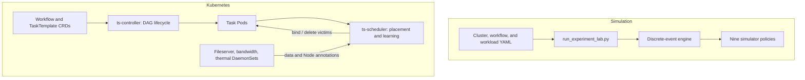

# TaskScheduler

TaskScheduler is an experiment lab and Kubernetes control plane for scheduling
directed acyclic graph (DAG) workflows on heterogeneous clusters. It combines a
deterministic discrete-event simulator with a deployable Workflow controller
and custom scheduler.

> **Evidence status:** exploratory simulation, fresh-seed confirmation,
> Legacy weight search, factor studies, and a six-trial Legacy/Adaptive Kind
> pilot are complete. The final three-policy, three-topology same-host Kind
> matrix also completed and passed strict analysis with 27 trials, 135
> workflows, and 540 successful final tasks. Physical multi-machine k3s
> validation is still pending. The
> simulator and live scheduler are separate implementations over partly shared
> models; they do not run identical policy code.

## Contents

- [Overview](#overview)
- [Architecture](#architecture)
- [Policies](#policies)
- [Learning and Locality](#learning-and-locality)
- [Evidence](#evidence)
- [Project Structure](#project-structure)
- [Prerequisites](#prerequisites)
- [Simulation Lab](#simulation-lab)
- [Kubernetes Deployment](#kubernetes-deployment)
- [Monitoring & Debugging](#monitoring--debugging)
- [Testing](#testing)
- [Cleanup](#cleanup)

---

## Overview

The project answers two related questions:

1. How do FCFS, Random, EFT, HEFT, three distinct Legacy variants, and
  Adaptive policies behave across heterogeneous DAG and overlapping-arrival
  scenarios?
2. Can the intended lifecycle, learning, locality, telemetry, binding, and
  kill/restart preemption paths execute through a real Kubernetes API?

The simulator provides controlled policy comparison. The live system provides
end-to-end integration evidence and descriptive same-host timing. Kind worker
containers share one physical machine, so the live results are not evidence of
independent network, thermal, or failure domains.

The current evidence supports policy selection by objective:

| Objective | Current recommendation |
|---|---|
| Static, known DAG | HEFT; EFT is a close simpler baseline |
| Energy-sensitive overlap | EFT or HEFT |
| Deadline hit rate in the simulator model | Historical simulator Legacy |
| Exact live Legacy or batch completion required | Tuned Legacy rather than Legacy v1 |
| Median regular-workflow response | Adaptive, when restart cost is acceptable |
| Restart cost dominates | Adaptive no-preempt in simulation; live validation remains future work |

---

## Architecture



The controller creates a Pod only after its dependencies finish. The live
scheduler watches Pending Pods with `schedulerName: ts-scheduler`, invokes the
selected policy, applies victim deletions, and binds placements. The controller
then records outputs, retries interrupted tasks, and recursively terminates
descendants blocked by failed parents.

The controller knows the complete Workflow DAG. The current scheduler adapter
receives only the ready-Pod frontier and reconstructs no future edges, so the
live experiment does **not** validate full HEFT upward-rank ordering.

---

## Policies

### Simulator

| Policy | Ordering and placement |
|---|---|
| FCFS | Ready-list order and first feasible placement |
| Random | Seeded random feasible placement |
| EFT | Greedy minimum estimated finish time |
| HEFT | Full-DAG upward rank, then EFT placement |
| Legacy | Historical simulator heuristic: EFT plus specialization and fragmentation terms |
| Legacy v1 | Exact live eight-factor scorer with the original weights |
| Legacy tuned | Exact live scorer with train/validation/holdout-selected weights |
| Adaptive | Priority + HEFT order; finish, energy, transfer, thermal, and failure score; priority preemption |
| Adaptive no-preempt | Exact Adaptive score and order with preemption disabled |

The simulator models shared CPU, cache, memory bandwidth, storage, routed
network capacity, thermal throttling, power, failures/repair, checkpoints,
gangs, releases, and functional priority preemption.

### Kubernetes

`TS_POLICY=legacy` is a backward-compatible alias for `legacy-v1`; the static
Kustomize deployment currently selects `adaptive`. Both Legacy names use the
original exact eight-factor score: type affinity,
resource fit, warm image, load, availability, failure history, parent locality,
and memory pressure. `TS_POLICY=legacy-tuned` changes only those eight weights;
coverage, random exploration, profile learning, and tie-breaking are unchanged.

`TS_POLICY=adaptive` orders the ready frontier by priority, virtual runtime,
arrival, and stored rank. It minimizes occupancy-aware expected finish time,
an optimistic UCB adjustment, observed failure cost, and a thermal-headroom
penalty. It supports atomic gang rollback and bounded kill/restart preemption.

---

## Learning and Locality

Successful live Pods update per-task-template, per-node startup and runtime
profiles. Profiles are persisted to a file and ConfigMap and survive scheduler
Pod replacement.

- Legacy samples every candidate, gathers at least three observations per node,
  then retains a 10% random exploration branch.
- Adaptive forces the least-observed feasible candidates to three samples,
  then uses an optimistic UCB cost adjustment during exploitation.
- Cold pairs use 2 s startup and 10 s runtime defaults.
- Observed failures increase task/node risk cost.

Each node owns `/var/lib/ts-data`. The controller propagates producer node and
output byte metadata. Same-node children read the host path directly;
cross-node children fetch from `ts-fileserver` over HTTP. The same provenance
drives Adaptive's transfer estimate before binding.

## Evidence

| Corpus | Size | Headline result |
|---|---:|---|
| Closed DAG exploration | 13,800 records; 1,500 cases | Nine policies plus 300 tractable static-oracle references |
| Closed DAG confirmation | 26,250 records; 3,750 cases | HEFT has 1.69% mean deployable regret; EFT is the close second |
| Overlapping exploration | 3,600 records; 400 cases | Nine-policy objective and tail comparison |
| Overlapping confirmation | 7,000 records; 1,000 cases | Historical Legacy leads deadline hit; Adaptive leads response tail; EFT/HEFT lead energy |
| Legacy tuning | 256 candidates; 90/45/75 train/validation/holdout cases | Tuned exact Legacy improves v1 under cold and warm holdout profiles; P95 makespan is unchanged |
| Same-host Kind pilot | 6 trials; 30 workflows; 120 final tasks | Adaptive lowers median workflow response 25.18% but raises makespan 21.30% with 17 kill/restart preemptions |
| Same-host Kind topology matrix | 27 trials; 135 workflows; 540 final tasks | 100% completion; tuned lowers v1 makespan in 3/3 profiles; Adaptive lowers median response 19.40% vs tuned but raises makespan 14.80% with 44 preemptions |

Raw and derived artifacts are under `results/`. See `ENGINEERING_JOURNAL.md`
for the decision log, incident history, evidence map, and rejected claims.

---

## Project Structure

```
TaskScheduler/
├── simulation/                  # Event engine, resource model, policies, analysis
├── scenarios/
│   ├── clusters/                # Five calibrated/synthetic cluster families
│   ├── workflows/               # Fifteen closed DAG families
│   └── workloads/               # Four overlapping arrival traces
├── controlplane/
│   ├── controller/main.py       # Workflow lifecycle and dependency progression
│   └── scheduler/main.py        # Live placement, binding, learning, preemption
├── services/                    # Live policies, ECT, profiles, data, telemetry
├── models/                      # Shared domain models and profile store
├── crds/                        # Workflow and TaskTemplate CRDs
├── manifests/                   # Root Kustomize installation resources
├── images/                      # Controller, fileserver, probe, thermal images
├── tasks/                       # CPU, memory, and I/O task images
├── examples/                    # TaskTemplates and sample Workflow objects
├── experiments/k8s/            # Live experiment TaskTemplates
├── results/                     # Retained raw records and summaries
├── tests/                       # Simulator, service, and control-plane tests
├── thesis/                      # LaTeX paper and generated PDF
├── run_experiment_lab.py        # Closed and overlapping simulation CLI
├── tune_legacy_weights.py       # Normalized train/validation/holdout search
├── analyze_final_evidence.py    # Exploratory/confirmatory synthesis
├── run_k8s_experiment.py        # Cyclic multi-policy live harness
├── scripts/run-kind-topology-matrix.ps1
│                                # Recreate and run three Kind profiles
├── analyze_kind_topologies.py   # Integrity gate and live aggregation
└── ENGINEERING_JOURNAL.md       # Decisions, incidents, evidence, open work
```

---

## Prerequisites

| Tool | Version | Purpose |
|------|---------|---------|
| Python | 3.12 tested | Simulator, controller, scheduler, and harnesses |
| Docker Desktop | 29.x tested | Images and local node containers |
| Kind | 0.32 tested | Repeatable same-host Kubernetes |
| kubectl | 1.36 tested | Install and inspect the control plane |
| GNU Make + Bash | Optional on Windows | Convenience targets and k3s scripts |

---

## Simulation Lab

```powershell
python -m venv .venv
.\.venv\Scripts\Activate.ps1
python -m pip install -r requirements.txt
python -m pytest
```

Run a small closed-DAG comparison:

```powershell
python run_experiment_lab.py run `
  --clusters balanced-heterogeneous-4 `
  --workflows diamond,fanout-1to8 `
  --policies fcfs,eft,heft,legacy,legacy-v1,legacy-tuned,adaptive-no-preempt,adaptive `
  --seeds 0:2 `
  --sample-uncertainty `
  --output results/local-closed-smoke
```

Run a small overlapping-arrival comparison:

```powershell
python run_experiment_lab.py workload `
  --clusters balanced-heterogeneous-4 `
  --workloads priority-burst `
  --policies fcfs,eft,heft,legacy,legacy-v1,legacy-tuned,adaptive-no-preempt,adaptive `
  --seeds 0:2 `
  --sample-uncertainty `
  --output results/local-workload-smoke
```

The CLI writes raw JSON Lines and CSV plus derived JSON and Markdown summaries.
`run_simulation.py` remains as an older in-process learning demo; it is not the
source of the definitive experiment matrices.

Run the reproducible Legacy search or factor checks:

```powershell
python tune_legacy_weights.py --candidates 256 --finalists 25
python run_legacy_ablation.py --seeds 300:310
python run_legacy_factor_stress.py
python analyze_final_evidence.py
```

The search is finite and objective-specific. The selected vector is the best
eligible validation finalist observed in that search, not a global optimum.
The final analyzer reads the retained exploratory and confirmatory JSONL files
and regenerates `results/final-evidence-synthesis.json` and its Markdown
companion with deterministic bootstrap seed 2026.

---

## Kubernetes Deployment

Every supported local profile has one control-plane container and worker
containers on the same Docker host. The final local matrix uses these three
low-footprint profiles:

| Profile | Workers | Purpose |
|---|---|---|
| `small` | CPU_OPT 2 CPU/1024 MiB; MEM_OPT 1 CPU/1536 MiB; IO_OPT 1 CPU/768 MiB | Balanced heterogeneous |
| `homogeneous` | Three CPU_OPT workers, each 1.25 CPU/1280 MiB | Equal-capacity control |
| `skewed` | CPU_OPT 2.5 CPU; MEM_OPT 1792 MiB; IO_OPT advertised I/O 1500 | Strong resource asymmetry |

`setup_cluster.sh big` remains available for a six-worker, higher-memory local
profile but is not part of the low-footprint topology matrix.

On Windows, run the Make/Bash commands from Git Bash or WSL with Docker,
Kind, and kubectl available on `PATH`.

### One-command smoke test

```bash
make smoke
```

This recreates the small Kind cluster, builds and loads all seven images,
installs the CRDs/control plane/node agents, applies the sample templates and
workflow, and waits for `linear-pipeline-1` to finish.

### Step-by-step

```bash
make cluster                 # setup_cluster.sh small + Docker cgroup caps
make images                  # controller, agents, and three task images
make load                    # load all images into ts-cluster
make install                 # kubectl apply -k . and wait for rollouts
make examples                # TaskTemplates + linear-pipeline-1
make watch-workflow          # wait for the Workflow CRD to finish
```

The installation entry point is the repository-root `kustomization.yaml`.
It installs both CRDs, RBAC, controller and scheduler Deployments, and the
fileserver, bandwidth-probe, and thermal DaemonSets.

### Select a live policy

The static Kustomize manifest selects Adaptive. Select an explicit policy and
wait for the new scheduler Pod:

```bash
kubectl -n ts-system set env deployment/ts-scheduler TS_POLICY=adaptive
kubectl -n ts-system rollout status deployment/ts-scheduler --timeout=120s
kubectl -n ts-system logs deployment/ts-scheduler --tail=50
```

Use `TS_POLICY=legacy-v1`, `legacy-tuned`, or `adaptive` for comparisons;
`legacy` remains an alias for v1. The startup log identifies the selected
implementation; verify it before collecting results.

### Run the retained live protocol

The harness deletes only objects labeled for its experiment, rotates policy
order by repetition, isolates profile state by policy/run, records exact Legacy
weights, and writes partial results after every trial:

```powershell
python run_k8s_experiment.py `
  --policies legacy-v1 legacy-tuned adaptive `
  --repetitions 3 `
  --topology-name small `
  --output results/k8s-kind/policy-comparison-local.json
```

Run the complete same-host topology matrix from PowerShell:

```powershell
& .\scripts\run-kind-topology-matrix.ps1 `
  -Profiles small,homogeneous,skewed `
  -Repetitions 3 `
  -Seed 2026

python analyze_kind_topologies.py
```

The runner deliberately recreates `ts-cluster` for each profile and must not
share the host with a simulator benchmark. The analyzer rejects incomplete
artifacts, failed final tasks, container restarts, scheduler errors, incorrect
weights, missing policies/repetitions, and cross-policy profile reuse. Its JSON
and Markdown outputs include topology-level, aggregate, and per-workflow-shape
response summaries for final policy recommendations, plus per-repetition
makespan/response sequences for assessing whether policy-isolated profile
accumulation coincides with improvement.

The retained matrix passes every gate: 27/27 trials, 135/135 workflows, and
540/540 final tasks complete successfully, with no final task failure,
scheduler error, collection error, or container restart.

The earlier six-trial pilot remains at
`results/k8s-kind/policy-comparison.json`. It compares original exact Legacy
with Adaptive and is formative mechanism evidence, not part of the final
three-policy aggregate.

### Physical k3s path

`cluster.env.example`, `scripts/k3s-server.sh`, `scripts/k3s-agent.sh`, and the
`make k3s-*`, `images-multiarch`, and `install-remote` targets define a
multi-machine path. That path has not been executed for the retained evidence.
Do not describe script availability as completed physical validation.

---

## Monitoring & Debugging

```bash
# Control-plane and node-agent health
kubectl -n ts-system get deployments,daemonsets,pods -o wide

# Controller and scheduler logs
make logs-controller
make logs-scheduler

# Workflow state and task placement
kubectl get workflows -A
kubectl get pods -A -o wide

# Declared heterogeneity
kubectl get nodes -L node-type -L ts.capacity/cpu -L ts.capacity/memory

# Bandwidth and thermal annotations for one node
kubectl get node ts-node-cpu-1 -o yaml | grep -E 'ts.io/(bw-from|cpu-temp)'

# Persisted scheduler profile ConfigMap
kubectl -n ts-system get configmap ts-scheduler-profiles -o yaml
```

For a failed Workflow, inspect its `status.tasks`, the controller log, the
scheduler log, and the final Pod log. A deleted preemption victim is recreated
as a new Pod, so it will not appear as a container restart on the final Pod.

---

## Testing

The main executable gate is:

```powershell
python -m pytest
```

The suite covers schemas and scenario provenance, virtual time, resource
conservation, thermal behavior, policies, failures/checkpoints, gangs,
preemption, experiment output, live ECT/UCB, controller retry/failure
propagation, scheduler binding/deletion, and the live harness.

Additional build checks:

```bash
python -m compileall simulation services controlplane models
kubectl kustomize . > /dev/null
kubectl apply --dry-run=server -k .   # requires a reachable cluster
cd thesis && latexmk -pdf -interaction=nonstopmode -halt-on-error thesis.tex
```

---

## Cleanup

```bash
make uninstall   # remove TaskScheduler resources from the current cluster
make clean       # delete the local Kind cluster
```

The live experiment harness removes its own labeled Workflow and Pod objects
unless `--keep-workflows` is supplied. It does not delete the retained JSON
result artifact.
