# TaskScheduler

TaskScheduler is a research platform for scheduling DAG workflows on
heterogeneous clusters. It has two execution surfaces that share one set of
scenario descriptions:

- a deterministic **discrete-event simulator** (`simulation/`) that models
  CPUs with SMT, caches and DRAM, storage, routed networks with max-min
  sharing and TCP limits, heating and throttling, energy, failures,
  checkpoints, gangs, priorities and preemption; and
- a **Kubernetes control plane** (Workflow and TaskTemplate CRDs, a DAG
  controller, a custom scheduler, a producer-local data plane, and node
  telemetry DaemonSets).

A calibrated **simulator twin** of each emulated Kind cluster connects the
two, so simulated conclusions can be checked against a real control plane.

> **Evidence status (2026-10-03, correction round).** Simulation: exploratory
> (seeds 0-19), confirmatory (200-249) and untouched holdout (400-449)
> matrices over 5 clusters x 15 workflows and 4 overlapping workloads, plus
> targeted cold-start and priority studies and the Legacy/contextual
> searches. Live: same-host Kind validation of three emulated profiles
> (`balanced`, `homogeneous`, `edge`) with a calibrated twin. Physical
> multi-machine (k3s) validation has **not** been run. Everything produced
> before the correction round is archived in
> `results/archive/pre-correction-2026-10-03.zip`.

## Contents

- [Key results](#key-results)
- [Architecture](#architecture)
- [Policies](#policies)
- [Simulator model](#simulator-model)
- [Learning, locality and cold starts](#learning-locality-and-cold-starts)
- [Evidence](#evidence)
- [Project structure](#project-structure)
- [Prerequisites](#prerequisites)
- [Simulation lab](#simulation-lab)
- [Kubernetes deployment](#kubernetes-deployment)
- [Same-host validation matrix](#same-host-validation-matrix)
- [Monitoring and debugging](#monitoring-and-debugging)
- [Testing](#testing)
- [Documentation](#documentation)

---

## Key results

Closed DAGs, fresh untouched holdout (3,750 cases, every seed a perturbed
cluster instance):

| Policy | Mean regret | P95 regret | Win/tie |
|---|---:|---:|---:|
| **heft-ra** / **heft-ra-cap** | **0.37%** | **0.00%** | **95.39%** |
| heft | 12.42% | 49.02% | 80.05% |
| eft | 12.54% | 49.02% | 79.65% |
| adaptive | 13.21% | 57.83% | 71.95% |
| legacy-tuned | 18.34% | 73.00% | 56.64% |
| legacy-v1 | 27.80% | 173.88% | 52.91% |
| k8s-default | 160.69% | 1296.03% | 42.32% |

In simulation every scheduler plans with the exact parameters of the
cluster instance it runs on, and HEFT-RA's estimator uses the simulator's
own resource models, so these regrets are best-case figures; the live
trials below test the policies with learned estimates.

Overlapping workloads, fresh holdout (1,000 cases): `heft-ra-cap` has the
lowest median (0.00%) and P95 (63.76%) response regret and the highest
deadline hit rate (71.47%). For the urgent workflow alone the two families
win in different places: HEFT-RA is faster in the typical case (median
7.6 s against 9.7 s) and meets the urgent deadline as often, while Adaptive
(priority ordering plus preemption) bounds the worst case (P95 21.0 s
against 126.6 s).

Live Kind validation (3 emulated profiles, 9 policies, 162 trials, all
integrity checks passed): on four concurrent DAGs a HEFT-RA variant was
the fastest of the nine policies in 8 of 9 runs (makespan 0.917 of
HEFT's), because it keeps data-heavy producers where their consumers run;
the ordering of the other policies is not conclusive with nine trials. On
the priority batch, where the critical workflow arrives into a full
cluster, Adaptive serves it 12% faster than without preemption, while the
HEFT family, which ignores priority classes, is 1.48 times slower than
`kube-default` for it. The refresh fix removed the 30+ s idle stalls of the
first live run (longest stall after the fix: 10.3 s).
A calibrated simulator twin that models the measured slot-release latency
(2.3-2.8 s) matches live times within 3-8% on the heterogeneous profiles.

**Recommendation per workflow and cluster type**

| Situation | Use |
|---|---|
| Known DAGs on heterogeneous clusters, no urgent work | `heft-ra-cap` (HEFT-RA) |
| Data-heavy, fan-out, pipeline workflows; edge or uneven networks | `heft-ra-cap` |
| Homogeneous clusters | `heft` or `heft-ra-cap` (equivalent) |
| Overlapping workloads without urgent work | `heft-ra-cap` |
| Urgent workflows that may arrive into a cluster full of long batch work, worst case matters | `adaptive` (`adaptive-no-preempt` if restarts are expensive) |
| Urgent workflows with spare capacity, typical latency or deadline hits matter | `heft-ra-cap` |
| Failure-prone or hot fast nodes, mixed pipelines | `adaptive` or `legacy-tuned` (risk-averse) |
| Original eight-factor scorer required | `legacy-tuned`, re-validated live |
| Start-up latency matters | add image pre-pulling or lazy pulling |
| Stock Kubernetes scoring | avoid for DAG placement; keep a priority-first queue |

The full tables are in `results/final-evidence-synthesis.md`,
`results/mechanism-studies.md` and `results/kind-validation/summary.md`; the
reasoning behind every number is in `ENGINEERING_JOURNAL.md` and
`thesis/thesis.pdf`.

---

## Architecture

```mermaid
flowchart TB
  subgraph Simulation
    Scenarios[Cluster, workflow and workload YAML]
    Lab[run_experiment_lab.py]
    Engine[Discrete-event engine]
    Policies[11 policies + static oracle]
    Scenarios --> Lab --> Engine --> Policies
  end

  subgraph Kubernetes
    CRDs[Workflow and TaskTemplate CRDs]
    Controller[ts-controller: DAG lifecycle, Pods, status]
    Scheduler[ts-scheduler: ordering, placement, binding, preemption]
    Pods[Task Pods]
    Agents[Fileserver, bandwidth probe, thermal DaemonSets]
    CRDs --> Controller --> Pods
    Pods --> Scheduler
    Scheduler -->|bind / delete victims| Pods
    Agents -->|data, node annotations| Scheduler
  end

  subgraph Validation
    Lab2[kind_lab.py: emulated profiles]
    Harness[run_k8s_experiment.py]
    Twin[kind_twin_predict.py: calibrated twin]
    Report[analyze_kind_validation.py]
    Lab2 --> Harness --> Twin --> Report
  end
```



The controller creates a Pod only when the task's parents have succeeded and
annotates it with the workflow DAG, priority, gang size, logical requests and
the producer node and size of each input. The scheduler watches Pending Pods
with `schedulerName: ts-scheduler`, computes upward ranks from the published
DAG, runs the selected policy every tick (1 s), binds through the API (with
rollback when a bind fails), and deletes preemption victims. Outputs stay on
the producing node (`/var/lib/ts-data`) and children fetch them from that
node's fileserver, so data locality has a real cost.

---

## Policies

| Name | Ordering and placement | Simulator | Live |
|---|---|:---:|:---:|
| `fcfs` | First ready task to the first node that fits | yes | |
| `random` | Seeded random feasible node | yes | |
| `k8s-default` / `kube-default` | PrioritySort queue; LeastAllocated + BalancedAllocation + ImageLocality scores | yes | yes |
| `eft` | Readiness order; earliest estimated finish time | yes | yes |
| `heft` | Upward-rank order; EFT placement | yes | yes |
| `heft-ra` | HEFT order; contention-, image-, thermal- and failure-aware finish estimates; one-level lookahead | yes | yes |
| `heft-ra-cap` | `heft-ra` whose lookahead places children only into capacity that will actually be free | yes | yes |
| `legacy` | Historical simulator heuristic (continuity only) | yes | |
| `legacy-v1` | Exact eight-factor live scorer, original weights | yes | yes |
| `legacy-tuned` | Same scorer, searched weights | yes | yes |
| `adaptive` | Priority, then rank order; EFT plus energy/transfer/thermal/failure penalties; preemption | yes | yes |
| `adaptive-no-preempt` | `adaptive` without preemption | yes | yes |
| `oracle-static` | Exhaustive static assignment for small DAGs (reference, never a competitor) | yes | |
| `calibrate` | Round-robin warm-up used by the live harness | | yes |

Live HEFT-RA uses measured bandwidth annotations and learned runtime
profiles; the live validation clusters report no temperatures or failures, so
its thermal and failure terms are exercised only in simulation.

---

## Simulator model

- **Execution** is the roofline-style maximum of compute, DRAM, storage-read
  and storage-write times. CPU rates follow Amdahl's law, the thermal throttle
  factor and an SMT-aware node ceiling; cache-resident traffic does not reach
  DRAM.
- **Network**: shortest-path routes over a link graph; full-duplex links have
  one channel per direction, Wi-Fi is half duplex; max-min fair sharing; each
  TCP flow is also limited by window/RTT and by the Mathis loss bound.
- **Heat and energy**: first-order RC thermal model with exact
  throttle-crossing events; convex utilisation-power curve.
- **Failures**: per-node Poisson and scripted failures with repair, each node
  on its own random stream; checkpoints; gang-atomic restart.
- **Uncertainty**: a seed perturbs every performance, power, thermal,
  reliability and link parameter by factors uniform in `[1-u, 1+u]`, where `u`
  is the cluster's declared uncertainty or `--uncertainty-floor`, whichever is
  larger.
- **Lower bound**: an optimistic critical-path/aggregate-capacity bound used as
  a sanity check.

---

## Learning, locality and cold starts

- The live scheduler learns runtime and start-up per (task template, node):
  rolling medians, an EMA (alpha 0.3) for drift detection, failure counts. A
  template is explored until it has three observations on every compatible
  node; Legacy keeps 10% random exploration; Adaptive adds a UCB term.
- Data locality: transfer time is part of every finish-time estimate; HEFT-RA
  also accounts for concurrent transfers that share a link or a producer's
  egress.
- Image locality: images are explicit (size, registry route, per-node cache);
  HEFT-RA does not pay twice for a pull already in progress.
  `run_mechanism_studies.py` measures how much cold starts cost and how much
  image awareness recovers.

---

## Evidence

| Artifact | Content | Produced by |
|---|---|---|
| `results/sim/closed-{exploratory-s0-19,confirmatory-s200-249,holdout-s400-449}/` | Closed-DAG records and summaries | `run_experiment_lab.py run` |
| `results/sim/workload-*/` | Overlapping-workload records and summaries | `run_experiment_lab.py workload` |
| `results/final-evidence-synthesis.{json,md}` | Cross-phase rankings, contrasts, seed independence, family leaders | `analyze_final_evidence.py` |
| `results/mechanism-studies.{json,md}` | Cold-start and priority/preemption studies | `run_mechanism_studies.py` |
| `results/legacy-weight-search.json` | Tuned Legacy weights and holdout | `tune_legacy_weights.py` |
| `results/legacy-factor-ablation.json`, `legacy-factor-stress.json` | Factor importance | `run_legacy_ablation.py`, `run_legacy_factor_stress.py` |
| `results/contextual-policy-search.json` | Contextual portfolio search | `tune_contextual_policy.py` |
| `results/kind-validation/` | Live clusters, trials, twin predictions, validation report | `scripts/run-kind-validation.ps1` or `make kind-validation` |
| `results/archive/` | Pre-correction evidence | archive |

---

## Project structure

```
TaskScheduler/
├── simulation/                 # Engine, resources, estimators, policies, experiments, Kind twin
├── scenarios/
│   ├── clusters/               # Five cluster families
│   ├── workflows/              # Fifteen closed workflows
│   ├── workloads/              # Four overlapping workloads
│   ├── benchmark-suite.yaml    # 160-workflow generated corpus (contextual search)
│   └── policy-profiles/        # Contextual policy profile
├── controlplane/
│   ├── controller/main.py      # Workflow lifecycle, Pods, status
│   └── scheduler/main.py       # Live ordering, placement, binding, preemption
├── services/                   # Live policies, ECT, DAG metrics, preemption, cluster state
├── models/                     # Domain models and profile store
├── engine.py                   # Live scheduling tick (admission, readiness, actions)
├── crds/                       # Workflow and TaskTemplate CRDs
├── k8s/, kustomization.yaml    # RBAC, Deployments, DaemonSets
├── images/                     # Control-plane, fileserver, bandwidth-probe, thermal images
├── tasks/                      # CPU, memory and I/O task images (speed emulation)
├── clusters/                   # Kind configs; kind_profiles.yaml = validation profiles
├── experiments/k8s/            # Live TaskTemplates and batches
├── examples/                   # Sample TaskTemplates and Workflows
├── kind_lab.py                 # Build an emulated Kind profile (caps, netem, speeds)
├── run_experiment_lab.py       # Simulation matrices
├── run_mechanism_studies.py    # Cold-start and priority studies
├── analyze_final_evidence.py   # Cross-phase synthesis
├── tune_legacy_weights.py, run_legacy_ablation.py, run_legacy_factor_stress.py
├── tune_contextual_policy.py
├── run_k8s_experiment.py       # Live harness (warm-up + trials)
├── kind_twin_predict.py        # Twin calibration and predictions
├── analyze_kind_validation.py  # Integrity gate, live ranking, twin agreement
├── scripts/                    # Kind validation runner, k3s scripts, cluster checks
├── tests/                      # Unit, property and regression tests
├── thesis/                     # LaTeX source and PDF
└── ENGINEERING_JOURNAL.md      # Step-by-step history, decisions, evidence map
```

---

## Prerequisites

| Tool | Tested version | Purpose |
|---|---|---|
| Python | 3.12 | Simulator, tooling, controller and scheduler |
| Docker Desktop | 29.x | Images and Kind node containers |
| Kind | 0.32 | Same-host Kubernetes |
| kubectl | 1.36 | Installation and inspection |
| MiKTeX / TeX Live | any recent | Building the thesis |
| GNU Make + Bash | optional on Windows | Convenience targets, k3s scripts |

---

## Simulation lab

```powershell
python -m venv .venv
.\.venv\Scripts\Activate.ps1
python -m pip install -r requirements.txt
python -m pytest -q
```

A small comparison:

```powershell
python run_experiment_lab.py run `
  --clusters balanced-heterogeneous-4 --workflows diamond,fanout-1to8 `
  --policies fcfs,eft,heft,heft-ra,k8s-default,adaptive `
  --seeds 0:3 --sample-uncertainty --uncertainty-floor 0.1 `
  --output results/local-closed-smoke
```

The retained matrices were produced with:

```powershell
$closed = "fcfs,random,eft,heft,heft-ra,heft-ra-cap,k8s-default,legacy,legacy-v1,legacy-tuned,adaptive-no-preempt,adaptive"
$common = "eft,heft,heft-ra,heft-ra-cap,k8s-default,legacy,legacy-v1,legacy-tuned,adaptive-no-preempt,adaptive"
python run_experiment_lab.py run --seeds 0:20 --sample-uncertainty --policies $closed `
  --oracle-max-tasks 3 --output results/sim/closed-exploratory-s0-19
python run_experiment_lab.py run --seeds 200:250 --sample-uncertainty --uncertainty-floor 0.1 `
  --policies $common --output results/sim/closed-confirmatory-s200-249
python run_experiment_lab.py run --seeds 400:450 --sample-uncertainty --uncertainty-floor 0.1 `
  --policies $common --output results/sim/closed-holdout-s400-449
python run_experiment_lab.py workload --seeds 0:20 --sample-uncertainty --policies $closed `
  --output results/sim/workload-exploratory-s0-19
python run_experiment_lab.py workload --seeds 200:250 --sample-uncertainty --uncertainty-floor 0.1 `
  --policies $common --output results/sim/workload-confirmatory-s200-249
python run_experiment_lab.py workload --seeds 400:450 --sample-uncertainty --uncertainty-floor 0.1 `
  --policies $common --output results/sim/workload-holdout-s400-449
# fresh holdout, run once after heft-ra-cap was added
python run_experiment_lab.py run --seeds 600:650 --sample-uncertainty --uncertainty-floor 0.1 `
  --policies $common --output results/sim/closed-holdout2-s600-649
python run_experiment_lab.py workload --seeds 600:650 --sample-uncertainty --uncertainty-floor 0.1 `
  --policies $common --output results/sim/workload-holdout2-s600-649
python analyze_final_evidence.py
python run_mechanism_studies.py
python tune_legacy_weights.py --candidates 256 --finalists 25
python run_legacy_ablation.py --seeds 300:310
python run_legacy_factor_stress.py
python tune_contextual_policy.py --candidates 64 --thermal-step 60 --quiet
```

Seeds `0:20` are half-open (0-19). Never run simulations while live trials are
being timed: both share the same CPU.

---

## Kubernetes deployment

Two kinds of local cluster are available:

| Profile | Created by | Purpose |
|---|---|---|
| `small`, `big` | `setup_cluster.sh` (Kind configs in `clusters/`) | Demos; no emulated speeds or links |
| `balanced`, `homogeneous`, `edge` | `kind_lab.py create` (`clusters/kind_profiles.yaml`) | Validation: per-node slots, CPU/memory/I/O speeds, `tc netem` links, container caps |

Step by step (Git Bash or WSL on Windows):

```bash
make cluster PROFILE=balanced   # or small / homogeneous / edge
make images load install
make examples                   # sample TaskTemplates + linear-pipeline-1
make watch-workflow
```

Select a live policy:

```bash
kubectl -n ts-system set env deployment/ts-scheduler TS_POLICY=heft-ra
kubectl -n ts-system rollout status deployment/ts-scheduler --timeout=120s
kubectl -n ts-system logs deployment/ts-scheduler --tail=20   # prints "Policy: ..."
```

Live policy names: `kube-default`, `legacy-v1`, `legacy-tuned`, `eft`,
`heft`, `heft-ra`, `heft-ra-cap`, `adaptive`, `adaptive-no-preempt`, `calibrate`
(`legacy` is an alias of `legacy-v1`).

A physical two-host path is provided by `make k3s-server`, `make k3s-agent`
and `make verify-cluster` (see `scripts/`); it has not been used for the
retained evidence.

---

## Same-host validation matrix

```powershell
powershell -NoProfile -ExecutionPolicy Bypass -File scripts\run-kind-validation.ps1 `
  -Profiles balanced,homogeneous,edge -Repetitions 3 -Seed 2026
```

or `make kind-validation`. For every profile this:

1. creates the emulated cluster and records the applied qdiscs, caps and
   speeds (`results/kind-validation/<profile>-cluster.json`);
2. loads the images and installs the control plane;
3. refreshes bandwidth probes, runs the calibrated warm-up, and runs 2
   batches x 9 policies x 3 repetitions in seeded random order, every trial
   starting from the same warm profiles (`<profile>.json`);
4. calibrates the twin on the warm-up only and predicts every trial
   (`<profile>-twin.json`);

and finally `analyze_kind_validation.py` checks integrity and writes
`summary.{json,md}`. A full matrix takes about ten hours on an i5-8300H.
Twin predictions that also model the measured completion-to-rebind latency
are produced with `python kind_twin_predict.py results/kind-validation/<profile>.json
--slot-release measured` (written to `<profile>-twin-release.json`) and are
compared automatically when present. Results from before the scheduler
refresh fix are kept in `results/kind-validation/pre-fix-run/`.

---

## Monitoring and debugging

```bash
kubectl -n ts-system get pods -o wide
kubectl -n ts-system logs deployment/ts-scheduler --tail=100
kubectl -n ts-system logs deployment/ts-controller --tail=100
kubectl get workflows -A
kubectl get workflow <name> -o jsonpath='{.status.tasks}'
kubectl get nodes -L node-type,ts.io/kind-profile
kubectl get node <node> -o jsonpath='{.metadata.annotations}'   # bw-from-*, netem, speeds, thermal
kubectl -n ts-system get configmap ts-emulation -o yaml           # emulated speeds
```

---

## Testing

```powershell
.\.venv\Scripts\python.exe -m pytest -q
```

The suite covers the simulator models and properties (Hypothesis), every
audited regression, HEFT-RA, the live policies, controller and scheduler
behaviour, the preemption engine, the Kind lab and twin, the validation
analyzer and the evidence synthesis.

---

## Documentation

- `thesis/thesis.pdf` - the dissertation (introduction, state of the art,
  architecture, evaluation, limitations).
- `ENGINEERING_JOURNAL.md` - what was done, step by step, with examples,
  including the audit and every correction.
- `ARCHITECTURE.md` - component map.
- `summary.md` - one-page summary.
